# Book Genre Classification from Synopsis Text

**MSI5001 — Introduction to AI: Concepts, Applications, and Evaluation · Group 10**
Michael Merriot Sasmita · Rini Pinasthika · Tan Tit Ho · Teong Wei Kok

> The brief: take a given dataset, build and train a model on it. Accuracy was not the main goal — the insight gained from the data and the process was. This README follows that spirit: it walks through the questions we asked, in the order we asked them.

**Working constraints:** everything ran in Google Colab on free resources — CPU for the classical models, the free T4 GPU for DistilBERT. This shaped the model choices, feature limits and training budgets throughout.

---

## The thought process

### 1. "What are we actually being asked to do?"
We received `data.csv`: 4,657 book synopses (`summary`), each with one genre number (`genre`, 1–10): fantasy, science, crime, history, horror, thriller, psychology, romance, sports, travel.

Before choosing anything, we asked who would use a genre classifier and what a mistake would cost them. Two users came out of that:
- **Scenario A — someone types in a synopsis** and wants the right genre back. A wrong answer is the failure, so *precision* matters.
- **Scenario B — someone browses a genre** and doesn't want to miss books. A missing book is the failure, so *recall* matters.

Wanting to serve both is why weighted F1 later became our main metric. The use case we had in mind: automatic cataloguing, recommendations and search for libraries, bookstores and content providers. We accepted the single-label, 10-class framing as given — for now.

### 2. "What does the data really look like?"
We looked twice: once with code (shape, types, missing values, duplicates, genre counts) and once by eye in Excel and text editors, because code checks miss text that is technically valid but meaningless.

**Uneven genres (10.23 : 1).** Thriller has 1,023 books; psychology, sports and travel have 100 each; romance 111.

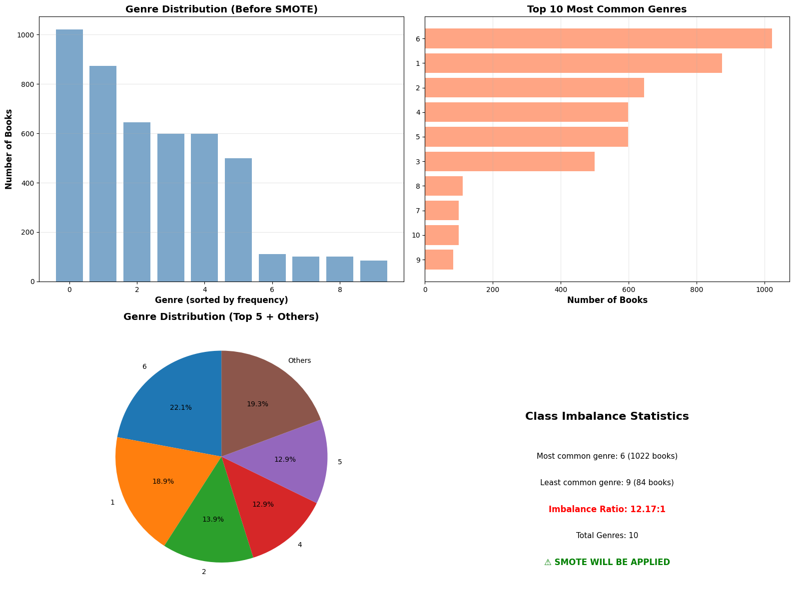

**Extreme lengths.** Synopses range from 1 word to over 5,000, with most between 100 and 300.

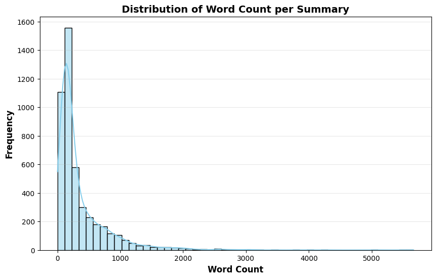

**Duplicates that disagree.** 18 exact duplicate rows, and 96 of 113 repeated summaries carry *different* genres in different copies — the data contradicts itself.

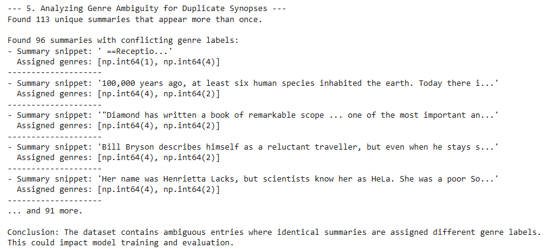

**Text with no meaning.** Placeholders such as "Plot outline description", "Receptio" and "Character".

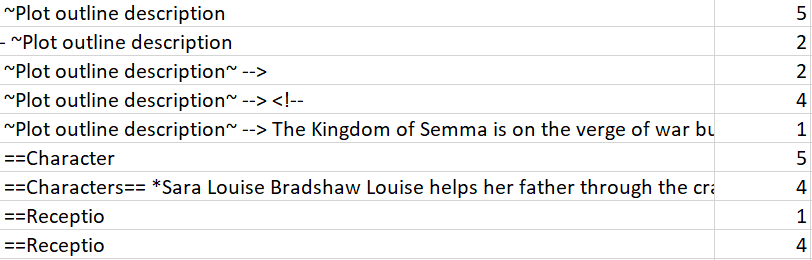

Also found: corrupted text and symbols, non-English words, mislabels, and books that genuinely mix genres (e.g. a romantic thriller forced into one label). There were no missing values and all labels were valid.

### 3. "How much should we change the data?"
Our instinct was to touch the data as little as possible. We removed only what was clearly unusable: the 18 exact duplicates and 7 summaries under 5 words (4,657 → 4,632 rows). We kept rows that *looked* mislabelled, because relabelling would impose our own opinion of the genre, and deleting rows would shrink the already-small genres further.

We also chose not to shorten long synopses: cutting would throw away genre clues, and TF-IDF (which weighs a word by how distinctive it is across the whole collection) already softens the effect of length.

### 4. "Which models, and how many?"
We wanted to see how much extra complexity actually buys on this data, within free Colab limits, so we picked three points on the spectrum:

| Role | Model | Why |
|---|---|---|
| Traditional ML | TF-IDF + Logistic Regression | Fast, CPU-only, interpretable (each genre gets a weight per word). Our baseline. |
| In between | fastText embeddings + XGBoost (started as spaCy tok2vec) | Better grasp of meaning while staying on CPU. At 6.5 h per run it couldn't be tuned in time, so it was dropped from deeper analysis. |
| Transformer | DistilBERT, fine-tuned on a free T4 GPU | Shows what modern language models can do. |

Plan: run all three, keep the two most promising, iterate on them, then compare.

### 5. "How should each model see the text?"
The right amount of cleaning depends on the model.

| | Cleaning | Normalisation | Features |
|---|---|---|---|
| **Logistic Regression** | Lowercase; remove URLs, emails, HTML, symbols; filter nonsense words | NLTK tokenisation, stopword removal, POS-tagged lemmatisation, keep 3–20 character words | TF-IDF, 5,000 features, words + two-word phrases |
| **fastText + XGBoost** | Lowercase | fastText tokeniser, stopwords kept | Embeddings weighted by TF-IDF |
| **DistilBERT** | None — case kept | DistilBERT tokeniser, stopwords and word forms kept | Token IDs → contextual embeddings |

A bag-of-words model treats every leftover token as a feature, so it gets heavy cleaning. The nonsense-word filter (repeated characters like "aaaa", vowel-less strings, number-heavy tokens, fillers like "umm") is a direct response to the corrupted text found in step 2. A transformer uses context, so removing "not" or flattening "ran" to "run" would throw away information it can use.

TF-IDF settings: 5,000 features (memory and time on a free CPU); unigrams + bigrams (to catch phrases like "serial killer"); sublinear term frequency (so repetition in long synopses doesn't dominate); `min_df=2`, `max_df=0.8` (drop the too-rare and the too-common).

### 6. "How do we stop the big genres from drowning the small ones?"
Each model got the technique that fits how it represents text:
- **Logistic Regression → SMOTE**, which creates synthetic examples by mixing TF-IDF vectors.
- **DistilBERT → upsampling + class-weighted loss**: copies of real minority examples, and a loss that penalises mistakes on small genres more. SMOTE can't synthesise raw text.

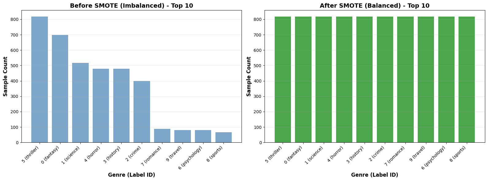

We tested whether this mattered rather than assuming it. Without SMOTE, Logistic Regression scored 0 on romance (label 8 below):

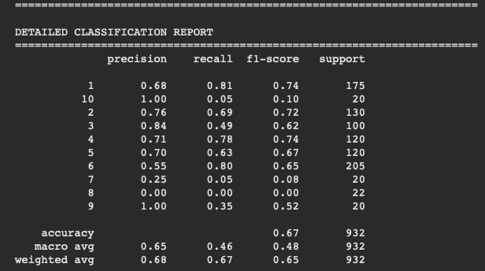

For DistilBERT, balanced and unbalanced runs differed by under 2% — we reasoned that pretraining already gives it knowledge of minority-genre vocabulary.

### 7. "Is every step earning its place?"
We kept an experiment log and tried removing or swapping parts of the pipeline:
- Standard SMOTE vs none → SMOTE needed.
- ADASYN (a SMOTE variant) → couldn't run; too few minority samples.
- All cleaning removed → almost no change, because TF-IDF already does basic cleaning.
- Removing duplicates and very short summaries.
- DistilBERT: 6 → 8 epochs with a lower learning rate, because training and validation loss were both still falling.

The log is also where the "versioning matters" lesson came from — without it, picking the final version would have been guesswork.

### 8. "How do we measure fairly?"
- **Stratified 80/20 split with a fixed random seed** — the smallest genres appear in the test set and results are reproducible.
- **5-fold cross-validation, with SMOTE applied inside each fold** — checks the score is stable rather than a lucky split, without leaking synthetic data built from validation rows into training.
- **Weighted F1 as the headline metric**, with accuracy, macro F1, precision and recall alongside — accuracy alone misleads at a 10 : 1 imbalance, and F1 balances Scenarios A and B.
- **Simple benchmarks** (random guessing, always predicting the biggest genre) — to show the model learned something.

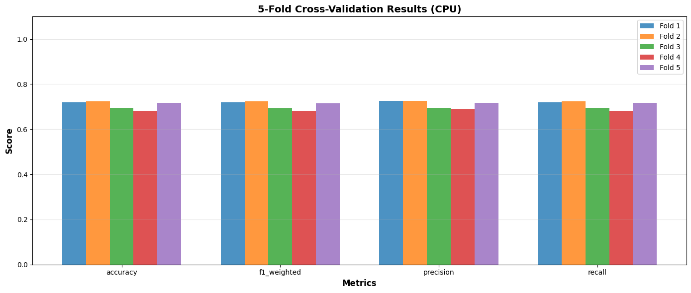

### 9. "Where and why does it go wrong?"
A single score didn't tell us enough, so we looked at the failures: which genre gets mistaken for which, the error rate per genre, the 266 misclassified test samples with their top-3 genres and probabilities, and predictions grouped by confidence (confident and right, confident and wrong, near misses).

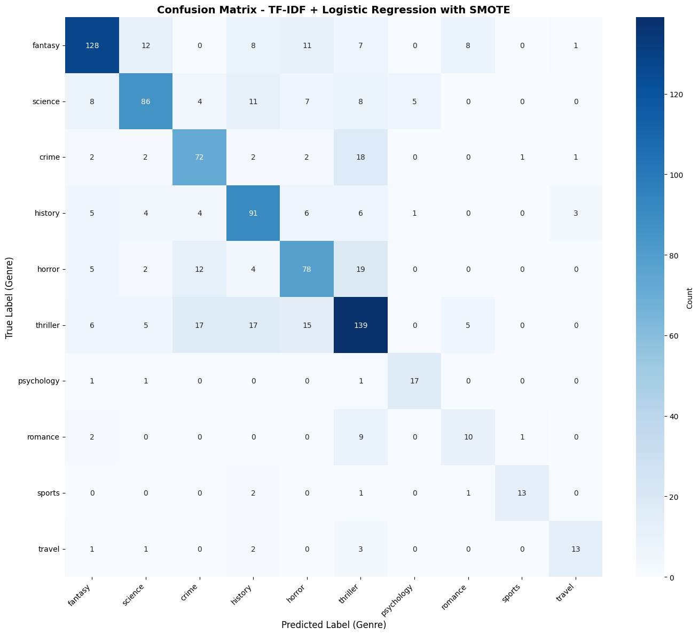

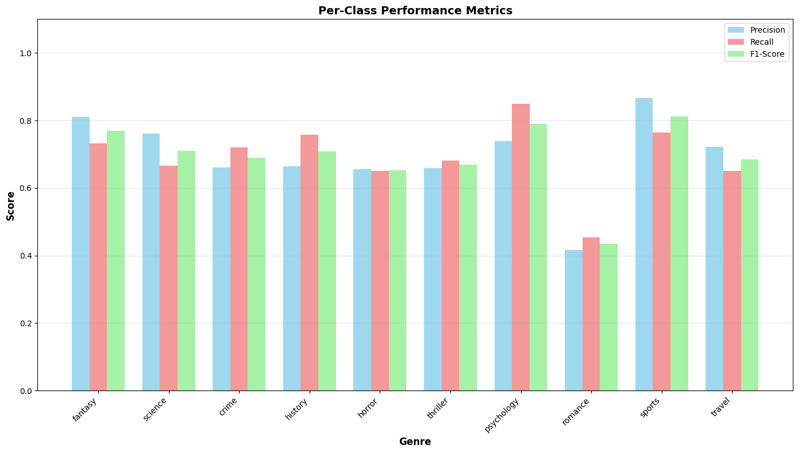

Then we put both models side by side on the same kinds of examples — fantasy-romance hybrids, the crime / thriller / horror cluster, popular-science books about the mind. The reasoning: **if both models make the same mistake, the cause is in the data, not the model.**

| Logistic Regression | DistilBERT |
|---|---|
| 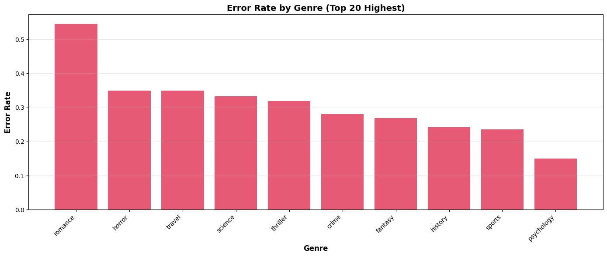 | 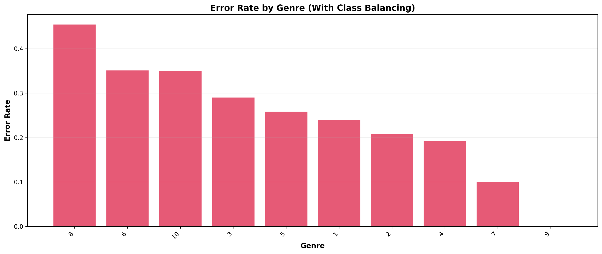 |

### 10. "Why did the model decide that — and can we trust it?"
We extracted Logistic Regression's word weights to see which words drive each genre:

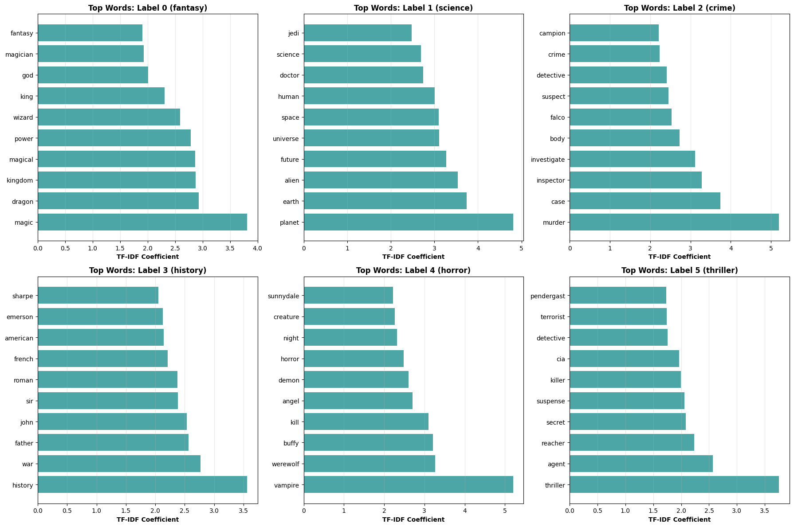

We described the two models by how they reason — Logistic Regression *"thinks in keywords"*, DistilBERT *"thinks in stories"* — and walked through real synopses to show it.

We compared how confident each model is **when it is wrong**, because a model is only trustworthy if it's unsure when it should be:

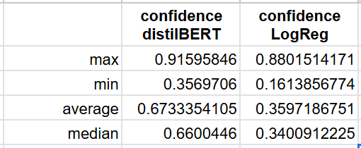

The prediction function returns the top 3 genres with probabilities rather than one answer, so close calls stay visible.

### 11. "Was the question itself right?"
The error analysis pushed us back to step 1. Many mistakes came from books that genuinely belong to two genres, or from genres that share vocabulary by nature. So we questioned the single-label framing and proposed:
- **multi-label** classification (one book, several genres), or
- **hierarchical** genres (e.g. a "Suspense" parent over crime, thriller and horror).

Recommendations tied back to the two users: for browsing (Scenario B), allow multiple genres and use Logistic Regression, which is more sensitive to ambiguity; for classifying a synopsis (Scenario A), use DistilBERT with more balanced data.

### 12. "What did we learn about AI in general?"
- **Traditional ML is still competitive** — a simple, interpretable model is a valuable benchmark.
- **Versioning and logs are essential.**
- **Class definition matters before any model is built** — don't force data into classes that don't fit it.
- **Data cleaning is complex, iterative and labour-intensive.**
- **Accuracy must be balanced** against training time and compute.
- **There are endless model options** — learn each one's characteristics before investing effort.

---

## Results at a glance

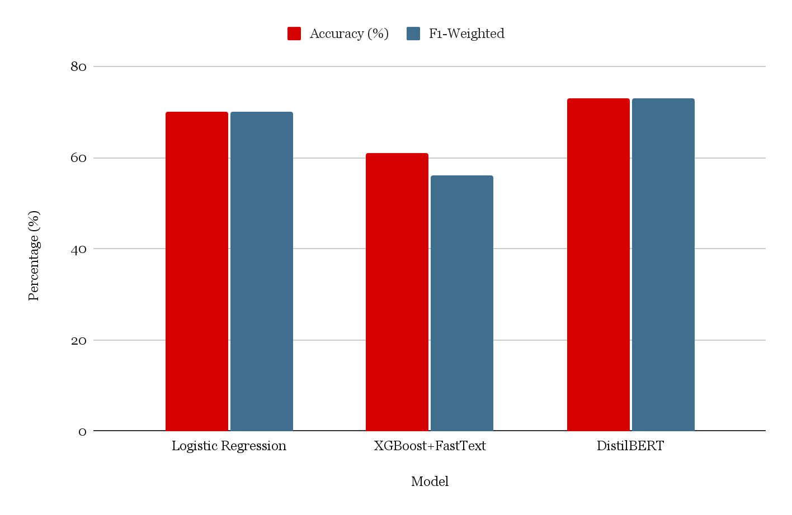

| Model | Imbalance handling | Result |
|---|---|---|
| TF-IDF + Logistic Regression | SMOTE | Accuracy 69.8%, weighted F1 0.70; 5-fold CV ≈ 70.7% ± 1.8; ~4 s training on CPU |
| fastText + XGBoost | — | Weighted F1 ≈ 61%; 6.5 h training |
| DistilBERT (8 epochs, T4) | Upsampling + class weights | Accuracy ≈ 72%, weighted F1 ≈ 74% |

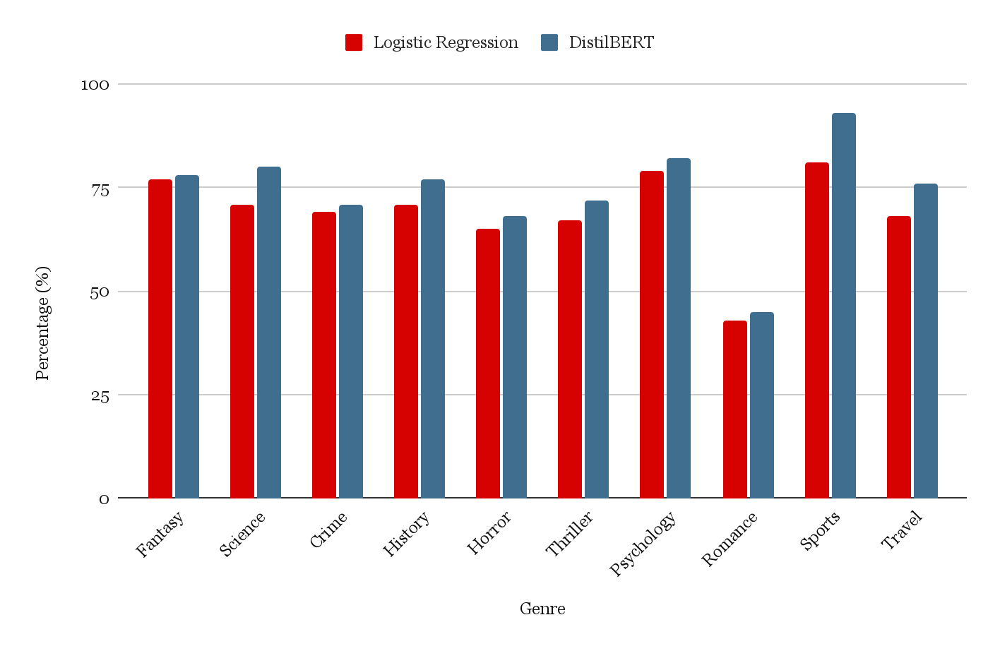

DistilBERT gains only a few points; romance is hardest for both; crime / thriller / horror form a confused cluster; Logistic Regression is cautious when wrong, DistilBERT overconfident.

## Repository contents
| File | What it is |
|---|---|
| `[FINAL]_TF-IDF,_LR,_SMOTE.ipynb` | Logistic Regression notebook (Colab, CPU) |
| `[FINAL]_distilBERT_8epochs.ipynb` | DistilBERT notebook (Colab, T4 GPU) |
| `[FINAL] XGBOOST.ipynb` | fastText + XGBoost notebook (Colab, CPU) |
| `misclassified_samples.csv` | 266 Logistic Regression test errors with top-3 probabilities |
| `genre_coefficients.csv` | Logistic Regression word weights per genre |
| `images/` | Charts used in this README |

## How to run
1. Open the notebook in Google Colab and set the runtime (CPU for Logistic Regression and XGBoost, T4 GPU for DistilBERT).
2. Run Section 1 (setup).
3. Run Section 2 and upload `data.csv` when prompted.
4. Run the remaining sections in order.
